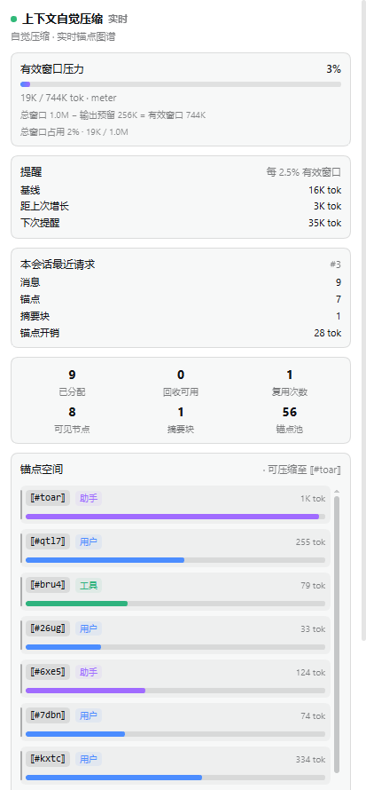

# dsh-context-decay（上下文自觉压缩）

面向 DeepSeek Harness 的**模型驱动的自觉压缩**插件。技术包名保留 `dsh-context-decay`，用于兼容宿主补丁、profile 和既有路径；产品名与所有面向模型/用户的文案统一为「上下文自觉压缩」。

模型自己选择压缩时机和范围，并亲自写摘要；当前回合始终保留。压缩后原文被摘要替代，摘要就是唯一记录。

> **安装说明**：这是**手动安装**插件，需要带 `modelMessageDecoration` 接缝的 DSH checkout 和宿主补丁；不是可直接上架、装上即用的插件市场包。



## 当前能力

- **四字符随机锚点**：每条有可见文本块的模型可见消息前加 `⟦#a8c5⟧` 形式的 4 位英文数字句柄；只有工具调用、没有文本的 assistant 回合按设计没有锚点。
- **确定性锚点池**：按持久 session id 预生成锚点池，同一会话内不重复发放；锚点不足低水位时自动扩池。被压缩区间内部的锚点回收进池，后续消息优先复用；摘要块保留左右边界作为自身句柄。
- **模型选段**：模型调用 `compress`，传一个或多个半开区间，并自己写每段摘要；不额外发 summarizer 请求。中间需要保留的内容留在可见区域，围绕它分多段压两侧；一次调用带上所有已用完的段，让前缀缓存保持有效。
- **只有 compress**：没有 `drop`、`decompress`、原文搜索或外部表；摘要必须自包含。
- **工具结果可压**：同一 assistant tool-call 消息的全部结果作为一个整体压缩；边界按 tool-call 组对齐，工具会返回可操作的提示。
- **当前回合保护**：活动回合及其工具结果保持原样。如果回合开头有无锚点的 system/运行时消息，把 `to` 设为其第一条可见锚点会保留这些消息，只压缩回合之前的历史；`"end"` 仍然表示可压缩历史末尾。
- **分层再压缩**：对已有块再压 → tier 2；更大范围合并继续升 tier。
- **极简提醒、不自动压**：每用掉有效窗口的 2.5% 注入一条提醒，只显示「已用 token/有效窗口」和百分比；提醒以「来自自觉压缩工具的提醒」开头，规则说明只放在 system prompt 和工具描述里。压缩始终由模型决定。
- **面板与审计**：侧栏显示压力、2.5% 提醒账本、锚点池、回收/复用、块、请求序号；可选 JSONL 审计。

## 环境要求

- DeepSeek Harness **0.2.1-rc.2**，并应用
  [`patches/dsh-model-message-decoration.patch`](patches/dsh-model-message-decoration.patch)。
  原生 DSH 没有这个装饰接缝；没有运行时回退。只安装插件不够，必须重建宿主。
- Node.js **>= 22.19**。
- Web profile；客户端依赖 `package.json` 中列出的 sidebar/session/locale UI 包。
- bundle patch 关闭官方**自动**压缩（`compaction-basic.auto: false`），保留手动
  `/compact`，并关闭原位 surface 改写器（`tool-result-pruner`、`image-offload`）。
  `/compact` 是应急的宿主兜底，它写的 checkpoint 不是 context-decay 的 tier 块。

## 安装

手动打补丁安装：

```bash
# 1. 给 DSH checkout 打 host patch，并重新构建
git -C /path/to/deepseek-harness apply /path/to/dsh-context-decay/patches/dsh-model-message-decoration.patch
pnpm -C /path/to/deepseek-harness install
pnpm -C /path/to/deepseek-harness build

# 2. 安装到 profile（checkout 或 tarball）
dsh plugin --profile web add /path/to/dsh-context-decay
# 或：dsh plugin --profile web add ./dsh-context-decay-0.1.0.tgz

# 3. 重启 Web
dsh web --profile web
```

完整流程（Windows 命令、验证、更新、回滚）见 [`docs/INSTALL.md`](docs/INSTALL.md)。

## 工具

| 工具                                             | 作用                                                                                                        |
| ------------------------------------------------ | ----------------------------------------------------------------------------------------------------------- |
| `compress({spans:[{from:"⟦#a8c5⟧", to:"⟦#c9d1⟧", summary:"..."}, {from:"⟦#e2f3⟧", to:"end", summary:"..."}]})` | 用一个或多个半开区间替换成自写摘要；`from`/`to` 是可见锚点，如 `"⟦#a8c5⟧"`（裸 `"#a8c5"` 或 `"a8c5"` 也接受）；`to` 还可以是 `"end"`；各 span 分别覆盖不同区域，相邻 span 可以相接；工具组边界按组对齐。 |

活动摘要块会内联打印自己的 pair：`⟦#<from>⟧ 摘要 ⟦#<to>⟧`。侧栏面板显示压力、提醒和块账本，不需要额外状态工具。

示例：

```text
# 单段压缩
compress({spans:[{from:"⟦#a8c5⟧", to:"⟦#c9d1⟧", summary:"读了三份需求文件，约束是……"}]})

# 一次调用压缩两个独立段
compress({spans:[
  {from:"⟦#a8c5⟧", to:"⟦#c9d1⟧", summary:"读了需求文件，约束是……"},
  {from:"⟦#c9d1⟧", to:"end", summary:"实现了解析器和测试……"}
]})

# 裸句柄也可以
compress({spans:[{from:"#a8c5", to:"end", summary:"……"}]})
```

上面的锚点只是示例；使用当前会话中可见的锚点。锚点是随机句柄，不代表消息先后。

## 时机与深扫

优先在开始新的一轮时压缩上一轮或更早的已消费历史；阶段或决策点结束、长输出已提炼成结论、话题切换、完成交接时也适合压缩。当前步骤仍依赖精确细节时，把压缩安排在阶段结束之后。

有效窗口压力超过约 **33%** 时，把压缩安排在开始新的一轮，并且做深扫：无论一次调用几个 span，第一个 span 从已消费边界开始，最后一个 span 结束于最新安全可压边界，通常是 `"end"` 或当前轮次第一条可见锚点；已消费内容都进入摘要，tail 保留仍然活跃的内容。工具会在该压力以上执行同样的深扫校验。

## 配置

| 键                             | 默认                   | 含义                                    |
| ------------------------------ | ---------------------- | --------------------------------------- |
| `enabled`                    | `true`               | 启用插件。                              |
| `contextWindowTokens`        | 路由值                 | 覆盖总窗口。                            |
| `reservedOutputTokens`       | 路由值                 | 覆盖输出预留。                          |
| `defaultContextWindowTokens` | `200000`             | 路由没有窗口时的回退值。                |
| `maxSpansPerCall`            | `8`                  | 单次`compress` 最大段数。             |
| `minSummaryChars`            | `20`                 | 摘要最小长度。                          |
| `maxSummaryChars`            | `8000`               | 摘要最大长度。                          |
| `maxMissTokens`              | `null`               | 可选一次性未命中 guard。                |
| `maxPaybackRequests`         | `null`               | 可选回本请求数 guard。                  |
| `audit`                      | `false`              | 写请求/压缩审计 JSONL。                 |
| `debug`                      | `false`              | 详细日志。                              |

**有效窗口** = 总窗口 − 输出预留。模型看到的压力是有效窗口占比；面板同时显示总窗口和预留，并显示总窗口占用行，便于对照内置上下文进度。压力、提醒和请求事实按 session 隔离，切换 session 时面板会更新。

提醒间隔固定为有效窗口的 2.5%；有效窗口压力超过约 33% 时，每开始新的一轮还会额外注入一条同类极简提醒。提醒间隔不通过配置改成分级阈值或自定义增长步长。

## 工作原理

宿主补丁增加 `modelMessageDecoration` 服务；插件注册装饰提供者，按 replay 状态给消息加前缀。agent-loop、token-meter 和请求 payload 使用同一份装饰。锚点来自 replay 的 surface 和确定性锚点池，不来自消息文本。

压缩写入 `compaction/start`、`compaction/summary`、替换用的 user 消息和 `compaction/end`；replay 重建块、tier、锚点引用计数和回收池。压缩只移除原文，不额外调用 summarizer。

状态模型、不变量和失败模式见 [`docs/ARCHITECTURE.md`](docs/ARCHITECTURE.md)。模型可见中文提示词、工具描述、提醒和错误文案见 [`docs/PROMPTS.md`](docs/PROMPTS.md)。

## 限制与非目标

- **不可恢复**：没有 decompress、搜索或 spill 归档；这是刻意取舍。
- **需要宿主补丁**：装饰接缝不在上游；没有补丁无法安全展示锚点或 replay 锚点。
- **不自动压缩**：提醒只是建议；模型可以忽略。官方自动策略已关闭，但手动 `/compact` 仍然可用。
- **`/compact` 是手动兜底**：它走官方后端并写官方 checkpoint，不是 context-decay 的 tier 块；只在会话已经大到无法正常请求时使用。
- **手动安装，不是市场包**：市场索引无法表达宿主补丁要求，`engines.dsh` 也无法区分打过补丁的宿主和原生宿主。
- **一个 profile 只配置一个压缩后端**：与其他压缩后端或原地 surface 改写器同时运行时，重放和 tool-call 配对更容易失稳。
- **replay 依赖当前事件格式**：压缩重放依赖当前 `surfaceOp` 和 compaction 事件形状。

## 开发

```bash
npm install          # 不在 DSH checkout 内构建时需要
npm run build        # src/ -> lib/（JS + 声明），client/ -> lib/client.js
npm run check        # 只做类型检查
npm test             # node:test，针对 lib/
```

本地开发可复用 DSH checkout 的 TypeScript：设置 `DSH_HARNESS_ROOT`，或把 checkout 放在同级目录。

## 许可

MIT，见 [LICENSE](LICENSE)。
