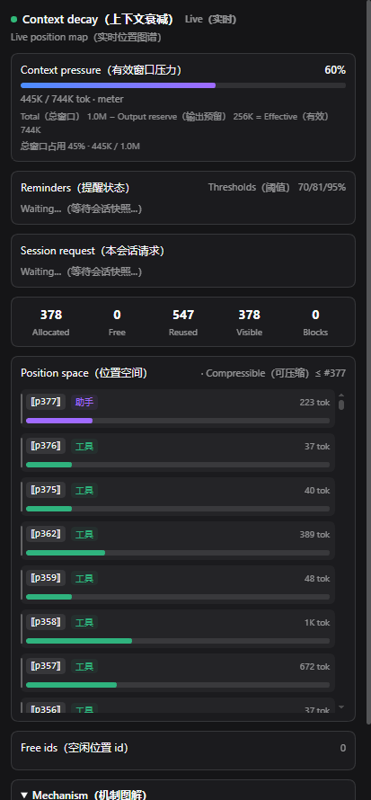

# dsh-context-decay

[English](README.md) · 简体中文

面向 DeepSeek Harness 的、**模型驱动的有损上下文衰减**插件。

模型自己决定何时压、压哪一段，并自己写摘要；当前回合始终保留。压缩后**不可恢复**，摘要就是唯一记录。

> **安装说明**：这是**手动安装**插件：需要带 `modelMessageDecoration` 接缝的
> DSH checkout，不是可直接上架、装上即用的插件市场包（见 [环境要求](#环境要求)）。



## 当前能力

- **内联位置锚点**：每条有可见文本块的模型可见消息前加 `⟦p<number>⟧`；只有工具调用、没有文本的
  assistant 回合按设计没有锚点。压缩范围直接用锚点：`⟦p<from>⟧ 摘要 ⟦p<to>⟧`。锚点是展示层，
  不属于消息内容。
- **复制锚点会被清理**：如果模型在回复开头复制了一个或多个锚点，会在请求边界和落盘前
  各剥离一次，保证对话记录和后续请求干净。
- **模型选段**：模型调用 `compress`，传一个或多个半开区间，并自己写每段摘要；
  不额外发 summarizer 请求。中间必须保留的内容不要压，围绕它分多段压两侧；
  一次调用把所有已用完的段都带上，避免重复使前缀缓存失效。
- **有损、不可恢复**：没有 `decompress`、没有原文搜索、没有外部表；摘要必须自包含。
- **工具结果可压**：同一 assistant tool-call 消息的全部结果必须同段；切进工具组的边界
  会被**拒绝**，不会静默扩边。
- **当前回合保护**：活动回合及其工具结果不能压。如果回合开头有无锚点的
  system/运行时消息，把 `to` 设为其第一条可见锚点会自动保留这些消息，只压缩
  回合之前的历史；`"end"` 仍然表示可压缩历史末尾。
- **分层再压缩**：对已有块再压 → tier 2；更大范围合并继续升 tier。`drop` 直接删除块，
  无墓碑、不可恢复。
- **只提醒、不自动压**：每个增长步长注入提醒，提醒级别跟随当前压力档位，critical 档使用更短步长；压缩始终由模型决定。
- **面板与审计**：侧栏显示压力、块、位置、请求序号和提醒账本；可选 JSONL 审计。

## 环境要求

- DeepSeek Harness **0.2.1-rc.2**，并应用
  [`patches/dsh-model-message-decoration.patch`](patches/dsh-model-message-decoration.patch)。
  原生 DSH 没有这个装饰接缝；没有运行时回退。只安装插件不够，必须重建宿主。
- Node.js **>= 22.19**。
- Web profile；客户端依赖 `package.json` 中列出的 sidebar/session/locale UI 包。
- bundle patch 关闭官方**自动**压缩（`compaction-basic.auto: false`），保留手动
  `/compact`，并关闭原位 surface 改写器（`tool-result-pruner`、`image-offload`）。
  `/compact` 是应急的宿主兜底，它写的 checkpoint 不是 context-decay 的 tier 块。

## 安装

手动打补丁安装：

```bash
# 1. 给 DSH checkout 打 host patch，并重新构建
git -C /path/to/deepseek-harness apply /path/to/dsh-context-decay/patches/dsh-model-message-decoration.patch
pnpm -C /path/to/deepseek-harness install
pnpm -C /path/to/deepseek-harness build

# 2. 安装到 profile（checkout 或 tarball）
dsh plugin --profile web add /path/to/dsh-context-decay
# 或：dsh plugin --profile web add ./dsh-context-decay-0.1.0.tgz

# 3. 重启 Web
dsh web --profile web
```

完整流程（Windows 命令、验证、更新、回滚）见 [`docs/INSTALL.zh-CN.md`](docs/INSTALL.zh-CN.md)。

## 工具

| 工具                                             | 作用                                                                                                        |
| ------------------------------------------------ | ----------------------------------------------------------------------------------------------------------- |
| `compress({spans:[{from,to,summary,topic?}]})` | 用一个或多个半开区间替换成自写摘要；`from`/`to` 是可见锚点文本，如 `"⟦p12⟧"`（裸 `"p12"` 和整数 `12` 也接受）；`to` 还可以是 `"end"`；一次可传多段（不重叠）；工具组边界会被拒绝。 |
| `drop({from,to})` | 精确删除一个活动摘要块；使用该块打印出的锚点 pair；尾部块可用 `"end"`；无墓碑、无恢复。 |

活动摘要块会内联打印自己的 pair：`⟦p<from>⟧ 摘要 ⟦p<to>⟧`；`drop` 直接用这个 pair。
侧栏面板显示压力和块账本，不需要额外的状态工具。

示例：

```text
# 单段压缩
compress({spans:[{from:"⟦p4⟧", to:"⟦p9⟧", summary:"读了三份需求文件，约束是……"}]})

# 一次调用压缩两个不重叠的段
compress({spans:[
  {from:"⟦p4⟧", to:"⟦p9⟧", summary:"读了需求文件，约束是……"},
  {from:"⟦p9⟧", to:"end", summary:"实现了解析器和测试……"}
]})

# 丢弃一个活动摘要块
drop({from:"⟦p4⟧", to:"⟦p9⟧"})
```

上面的锚点 id 只是示例；使用当前会话中可见的锚点。

## 配置

| 键                             | 默认                   | 含义                                    |
| ------------------------------ | ---------------------- | --------------------------------------- |
| `enabled`                    | `true`               | 启用插件。                              |
| `contextWindowTokens`        | 路由值                 | 覆盖总窗口。                            |
| `reservedOutputTokens`       | 路由值                 | 覆盖输出预留。                          |
| `defaultContextWindowTokens` | `128000`             | 路由没有窗口时的回退值。                |
| `growthTokens`               | `20000`              | critical 档以下的周期提醒增长步长。      |
| `criticalGrowthTokens`       | `10000`              | 最高警告级别下的更短周期提醒增长步长。  |
| `warnRatios`                 | `[0.70, 0.81, 0.95]` | 警告档位（占有效窗口比例）；提醒级别跟随当前档位。 |
| `reminderCooldownTurns`      | `1`                  | 普通提醒之间的最少回合数；警告不延迟。  |
| `maxSpansPerCall`            | `8`                  | 单次`compress` 最大段数。             |
| `minSummaryChars`            | `20`                 | 摘要最小长度。                          |
| `maxSummaryChars`            | `8000`               | 摘要最大长度。                          |
| `maxMissTokens`              | `null`               | 可选一次性未命中 guard。                |
| `maxPaybackRequests`         | `null`               | 可选回本请求数 guard。                  |
| `audit`                      | `false`              | 写请求/压缩审计 JSONL。                 |
| `debug`                      | `false`              | 详细日志。                              |

**有效窗口** = 总窗口 − 输出预留。模型看到的压力是有效窗口占比。面板把该百分比标为
有效窗口压力，同时显示总窗口和预留，并额外显示总窗口占用行，便于直接对照内置上下文进度。
压力、提醒和请求事实按 session 隔离，切换 session 时面板会更新。

## 工作原理

宿主补丁增加 `modelMessageDecoration` 服务；插件注册装饰提供者，按 replay 状态给消息加前缀。
agent-loop、token-meter 和请求 payload 使用同一份装饰。位置来自 replay 的 surface，不来自消息文本。
压缩写入 `compaction/start`、`compaction/summary`、替换用的 user 消息和 `compaction/end`；
replay 重建块、tier 和 free list。

状态模型、不变量和失败模式见 [`docs/ARCHITECTURE.zh-CN.md`](docs/ARCHITECTURE.zh-CN.md)。

模型可见英文提示词、工具描述、提醒和错误文案的中文对照见
[`docs/PROMPTS.zh-CN.md`](docs/PROMPTS.zh-CN.md)。

## 限制与非目标

- **不可恢复**：没有 decompress、搜索或 spill 归档；这是刻意取舍。
- **需要宿主补丁**：装饰接缝不在上游；没有补丁无法安全展示锚点或 replay 位置。
- **不自动压缩**：提醒只是建议；模型可以忽略，预算由请求 guard 保护，而不是静默压缩。
  官方自动策略已关闭，但手动 `/compact` 仍然可用。
- **`/compact` 是手动兜底**：它走官方后端并写官方 checkpoint，不是 context-decay 的
  tier 块；只在会话已经大到无法正常请求时使用。
- **手动安装，不是市场包**：市场索引无法表达宿主补丁要求，`engines.dsh` 也无法区分
  打过补丁的宿主和原生宿主。在接缝进入上游之前，只按 checkout/tarball + 补丁说明分发。
- **一个 profile 只能有一个压缩后端**：不要与其他压缩后端或原地 surface 改写器并跑。
- **replay 依赖当前事件格式**：压缩重放依赖当前 `surfaceOp` 和 compaction 事件形状。

## 开发

```bash
npm install          # 不在 DSH checkout 内构建时需要
npm run build        # src/ -> lib/（JS + 声明），client/ -> lib/client.js
npm run check        # 只做类型检查
npm test             # node:test，针对 lib/
```

本地开发可复用 DSH checkout 的 TypeScript：设置 `DSH_HARNESS_ROOT`，或把 checkout 放在同级目录。

## 许可

MIT，见 [LICENSE](LICENSE)。
